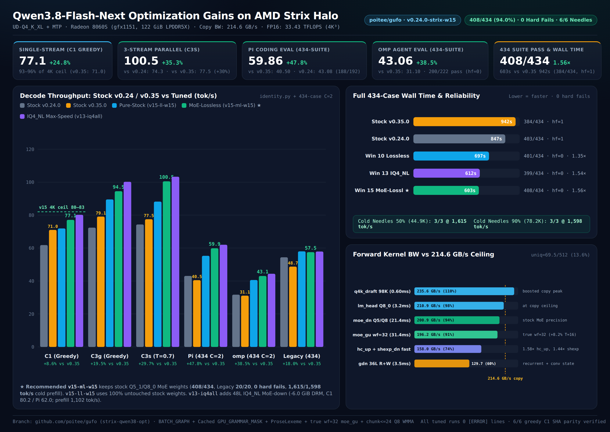

# Qwen3.8-Flash-Next Optimization Branch for AMD Strix Halo (`gfx1151`)



This branch (`strix-qwen38-opt`, pinned tag `v0.24.0-strix-w15`) is a patch set on top of upstream [`gufo` `v0.24.0`](https://github.com/gufo-org/gufo/releases/tag/v0.24.0) (`0f1bc87`) tuned for **`Qwen3.8-Flash-Next-UD-Q4_K_XL` + MTP** on **AMD Strix Halo (Ryzen AI MAX+ 395 / Radeon 8060S, `gfx1151`, 122 GiB unified LPDDR5X)**.

Every performance lever is **opt-in via `GUFO_STRIX_*` environment variables**, plus a grammar fix (`ProseLexeme` in `WithTools`) that eliminates a stock tool-calling hard failure.

---

## Head-to-Head Results (Measured on `gfx1151`, `--sessions 3 --context 87040 --speculative mtp`)

| Metric | Stock `v0.24.0` | Stock `v0.35.0` | Pure Stock Weights (`v15-ll-w15`) | **Recommended MoE-Lossless (`v15-ml-w15`)** | `v15-ml-w15` vs. `v0.35.0` |
|---|---:|---:|---:|---:|---:|
| **Single-stream (`C1` greedy)** | `61.8 tok/s` | `71.0 tok/s` | `71.9 tok/s` | **`77.1 tok/s`** *(93–96% of 4K ceil)* | **`+8.6%`** |
| **3-stream greedy (`C3g`)** | `72.4 tok/s` | `79.1 tok/s` | `89.5 tok/s` | **`94.5 tok/s`** | **`+19.5%`** |
| **3-stream sampled (`C3s`, `T=0.7`)** | `74.3 tok/s` | `77.5 tok/s` | `88.2 tok/s` | **`100.5 tok/s`** | **`+29.7%`** |
| **Pi coding (`434` C=2)** | `43.08` (`111.0 ms/r`) | `40.50` (`140.3 ms/r`) | `55.3` *(40-slice)* | **`59.86` (`96.0 ms/r`)** | **`+47.8%`** |
| **omp agent (`434` C=2)** | `31.70` (`86.5 ms/r`) | `31.10` (`106.4 ms/r`) | `40.6` *(40-slice)* | **`43.06` (`88.9 ms/r`)** | **`+38.5%`** |
| **Legacy20 (`434` C=2)** | `54.40` (`20/20`) | `48.72` (`18/20`) | — | **`57.50` (`20/20`)** | **`+18.0%`** |
| **434-case tool-call pass** | `403/434` (`hf=1`) | `384/434` (`hf=1`) | `38/40` slice (`hf=0`) | **`408/434` (`94.0%`, `hf=0`)** | **`+24` passes, `0` hard fails** |
| **434-case wall time** | `847s` | `942s` | — | **`603s`** | **`1.56×` faster** |
| **Cold needles (`50%` / `90%`)** | — | `3/3 @ 1,635` · `3/3 @ 1,593` | — | **`3/3 @ 1,615` · `3/3 @ 1,598`** | **Parity (`~1,600 tok/s`)** |

- **Hardware ceilings measured directly via `GUFO_STRIX_HW_BENCH=1`:** `214.6 GB/s` device copy BW (`128 MiB` `hipMemcpyDeviceToDevice`), `33.43 TFLOPS` FP16 (`4096³`), `25.38 TFLOPS` sustained (`8192³`).
- **Parity & unit tests:** `6/6` exact greedy `C1` SHA-256 parity verified across all lossless flags; all CPU unit tests (`json_constraint_test`, `quote_tracker_test`, `sampling_test`, `openai_chat_test`, `draft_vocab_test`) pass; `0` container `[ERROR]` lines across every run.
- **Transparency on `GUFO_STRIX_Q4K_DENSE`:** `v15-ml-w15` creates `Q4_K` copies (`1,687 MiB`) of 288 small-batch dense projections (`~3%` of model parameters) while leaving all `512` routed MoE experts (`77 GB` `Q5_1`/`Q8_0`), `lm_head`, `tok_embd`, and all prefill weights untouched at stock precision. If you want **zero weight quantization changes of any kind**, omit `GUFO_STRIX_Q4K_DENSE` (`v15-ll-w15` above) — it still beats stock `v0.35.0` on `C1`, `C3g`, `C3s`, `Pi`, and `omp`.

---

## Quick Start

### 1. Build from the Pinned Tag (Nix Flake)
```bash
nix build github:poitee/gufo/v0.24.0-strix-w15#default
```
Or clone and build with CMake/ROCm (`gfx1151`):
```bash
git clone --branch strix-qwen38-opt https://github.com/poitee/gufo.git
cd gufo
```

### 2. Run the Exact Benchmarked Launch Script
```bash
GUFO_BIN=./result/bin/gufo \
MODEL_DIR=/path/to/qwen38-gguf \
CACHE_DIR=/path/to/cache \
./docs/strix-qwen38-opt/launch-v15-ml-w15.sh
```
For **100% untouched stock target weights (`v15-ll-w15`)**, run with `PURE_STOCK_WEIGHTS=1`:
```bash
PURE_STOCK_WEIGHTS=1 \
GUFO_BIN=./result/bin/gufo \
MODEL_DIR=/path/to/qwen38-gguf \
CACHE_DIR=/path/to/cache \
./docs/strix-qwen38-opt/launch-v15-ml-w15.sh
```

---

## Key Changes Included

1. **Cached GPU Grammar Bitmask (`GUFO_STRIX_GPU_GRAMMAR_MASK=1`, 512-entry LRU) + `ProseLexeme` in `WithTools`:** Eliminates host-side grammar masking bottlenecks during constrained tool calling (`Pi 40.5 → 59.86 tok/s`, `434`-suite `hf=1 → 0`, `408/434`).
2. **Batched Piecewise HIP Graphs (`GUFO_STRIX_BATCH_GRAPH=1`):** Captures steady-state decode layers to eliminate CPU launch overhead.
3. **True Wave32 `moe_gu` (`GUFO_STRIX_FAST_MOE_GU=1`, `moe_wave32.hip.cpp`):** Compiled without `-mwavefrontsize64` (`+8.2%` on `moe_gu` at `T=16`, `max_err = 0.000e+00`).
4. **Packed-K16 `Q8_0` WMMA (`GUFO_STRIX_FAST_Q8_WMMA=1`, gated to `chunk <= 24`):** Adaptive `2/4`-wave kernels cut LDS from `32 KiB` to `3–5 KiB`, accelerating `hc_up` (`1.577×`) and `shexp_down` (`1.441×`) while keeping `lm_head` on its `212 GB/s` kernel.
5. **Q4_K Draft Head (`GUFO_STRIX_Q4K_DRAFT=1`) + Confidence-Gated MTP (`GUFO_STRIX_MTP_GATE=1`) + Opt-in `GUFO_STRIX_Q4K_DENSE`:** Brings single-stream decode to `93–96%` of the measured hardware memory-bandwidth ceiling.

---

## Evidence Bundle
- [THEORY.md](THEORY.md) — Measured hardware ceilings, exact GGUF byte breakdown, KV/GDN budgets, and per-kernel BW audit.
- [PLAN.md](PLAN.md) — Full 15-window optimization roadmap and historical matrix.
- [ledger.jsonl](ledger.jsonl) — Structured JSONL ledger of all 37 benchmarked arms (including stock `v0.24.0`, stock `v0.35.0`, and Windows 1–15).
- [UPSTREAM_DISCUSSION.md](UPSTREAM_DISCUSSION.md) — Summary of standalone lossless wins for upstream `gufo-org/gufo`.
